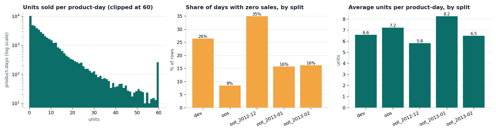
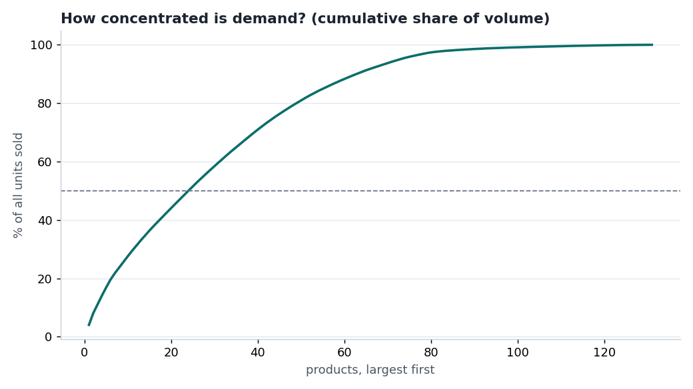
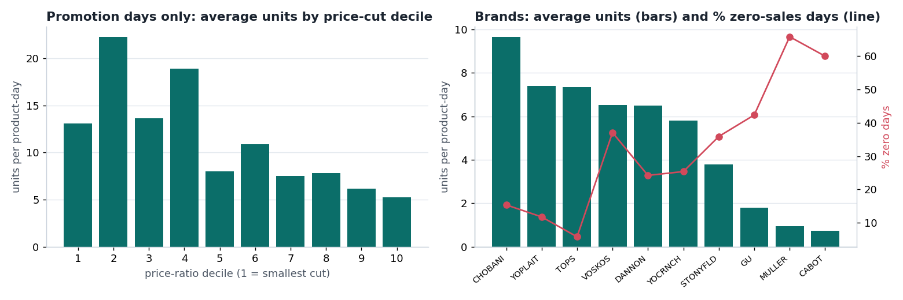
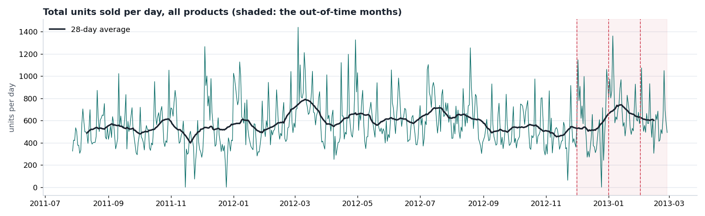
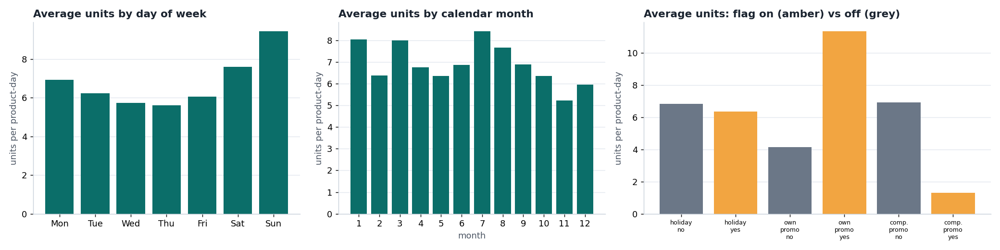
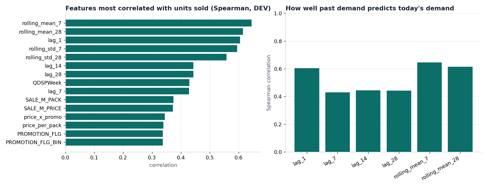
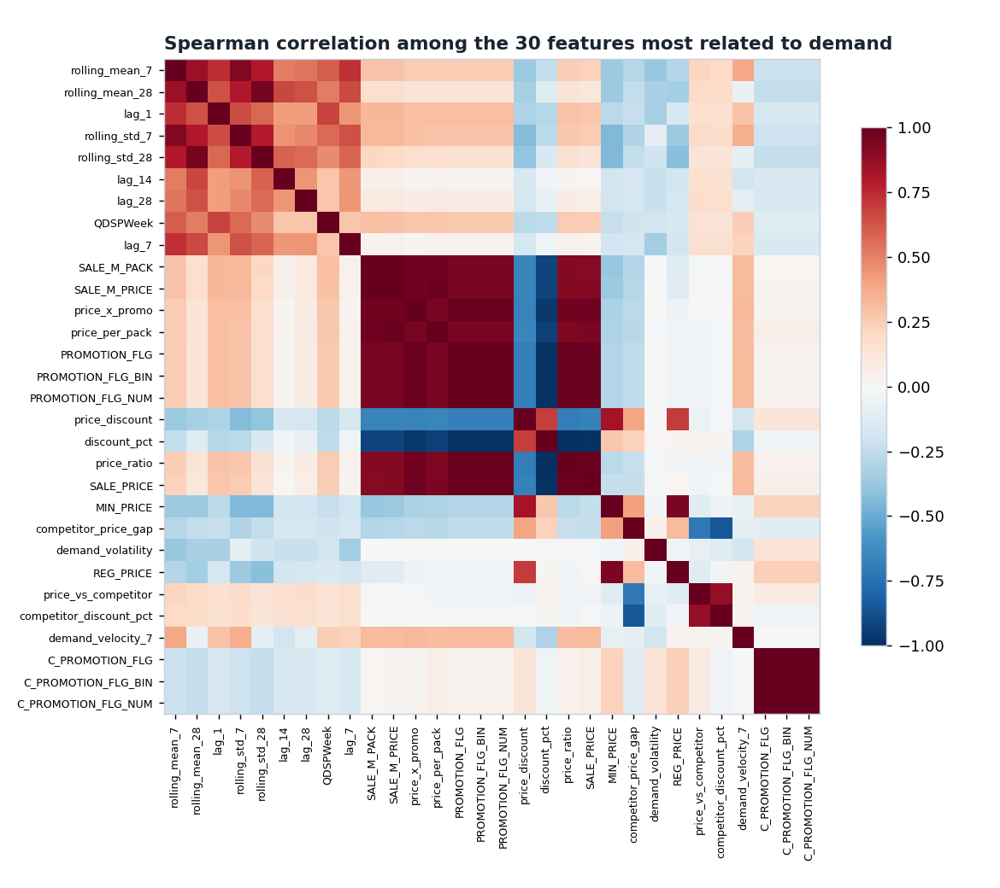
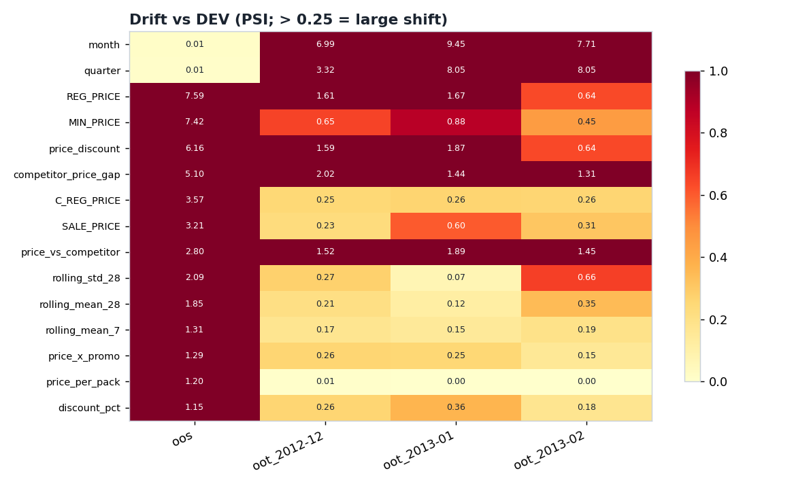

# DemandForecast — exploratory data analysis

Generated by `data/DemandForecast/scripts/run_eda.py`. Descriptive only: nothing here fits a model.
One row = one product (UPC) on one day in a single store; the target is `QUANTITY` (units sold).
The 51 model features are those used by the models and grouped by `feature_hierarchy.csv`.
Feature statistics use the DEV split; whole-history views use `features.csv`. Charts are in `EDA_Outputs/plots/`.

## 1. What the data looks like

- **49,393 rows**, 131 products, 10 brands, **one store**, 2011-07-28 to 2013-02-27.
- **Missing values in the model features: none.**
- **No gaps in time:** every product has a row for every day between its first and last record (coverage min 100%, median 100%),
  so a zero-sales day is an explicit row of 0 — not a missing day. Products start and stop at different dates.
- **Demand is small, skewed and zero-heavy:** mean 6.8 units, median 4, 99th percentile 47, maximum 171.
  **21% of product-days sell nothing.** The variance is 14.1× the mean (a Poisson count would have 1×), so demand
  is strongly over-dispersed — the reason a Tweedie loss was chosen for the tree models.

### Splits

| split | rows | products | brands | min_date | max_date | mean units | median | p99 | max | zero-sales % | promo % |
|---|---|---|---|---|---|---|---|---|---|---|---|
| dev | 26,803 | 85 | 6 | 2011-07-28 | 2012-11-30 | 6.57 | 3.00 | 55.00 | 171 | 26.41 | 21.46 |
| oos | 14,461 | 33 | 3 | 2011-07-28 | 2012-11-30 | 7.21 | 6.00 | 30.00 | 72 | 8.43 | 63.54 |
| oot_2012-12 | 2,925 | 95 | 9 | 2012-12-01 | 2012-12-31 | 5.82 | 2.00 | 53.76 | 126 | 34.87 | 33.30 |
| oot_2013-01 | 2,691 | 90 | 9 | 2013-01-01 | 2013-01-31 | 8.24 | 5.00 | 51.10 | 130 | 15.72 | 49.46 |
| oot_2013-02 | 2,513 | 96 | 9 | 2013-02-01 | 2013-02-27 | 6.48 | 4.00 | 32.88 | 83 | 16.16 | 38.44 |

**The splits are not alike.** The zero-sales share is 26% in DEV, 8% in OOS and 35% in December 2012.
OOS is a different set of brands from DEV (and holds only 3 brands), so scores on OOS reflect *which brands
were held out* as much as model quality — this very likely contributes to OOS R² being low and similar for every model (Section 4 shows how different OOS is).

### Brands and products

| BRAND | products | rows | mean units | zero-sales % | volume share % | appears in |
|---|---|---|---|---|---|---|
| CHOBANI | 34 | 11546 | 9.64 | 15.38 | 33.16 | dev, oot_2012-12, oot_2013-01, oot_2013-02 |
| TOPS | 16 | 9251 | 7.34 | 5.80 | 20.23 | oos, oot_2012-12, oot_2013-01, oot_2013-02 |
| DANNON | 23 | 10046 | 6.49 | 24.23 | 19.42 | dev, oot_2012-12, oot_2013-01, oot_2013-02 |
| YOPLAIT | 15 | 7377 | 7.39 | 11.78 | 16.24 | oos, oot_2012-12, oot_2013-01, oot_2013-02 |
| VOSKOS | 6 | 2333 | 6.53 | 37.08 | 4.54 | dev, oot_2012-12, oot_2013-01, oot_2013-02 |
| GU | 25 | 5716 | 1.80 | 42.35 | 3.06 | dev |
| STONYFLD | 3 | 1696 | 3.80 | 35.91 | 1.92 | dev, oot_2012-12, oot_2013-01, oot_2013-02 |
| YOCRNCH | 2 | 725 | 5.81 | 25.38 | 1.25 | oos, oot_2012-12, oot_2013-01, oot_2013-02 |
| MULLER | 4 | 518 | 0.94 | 65.83 | 0.15 | dev, oot_2012-12, oot_2013-01, oot_2013-02 |
| CABOT | 3 | 185 | 0.73 | 60.00 | 0.04 | oot_2012-12, oot_2013-01, oot_2013-02 |

The top 10 products carry 28% of all units, and 24 products account for half of the volume
.

### Products and brands the model never saw in training

| split | products | unseen_products | rows_from_unseen_products_pct | brands | unseen_brands | rows_from_unseen_brands_pct |
|---|---|---|---|---|---|---|
| oos | 33 | 33 | 100.0 | 3 | 3 | 100.0 |
| oot_2012-12 | 95 | 36 | 37.8 | 9 | 4 | 36.9 |
| oot_2013-01 | 90 | 39 | 41.2 | 9 | 4 | 39.7 |
| oot_2013-02 | 96 | 45 | 46.0 | 9 | 4 | 37.0 |

Out-of-time months contain products and brands that DEV never contained, so forecasting them is partly a cold-start problem.

## 2. Calendar, promotion and price

- **Promotions lift demand:** average units are 2.7× higher on a promotion day. Within the same product the median lift is
  3.0× (so it is not just promoted products being bigger sellers).
- **Day of week:** the busiest day averages 9.4 units (Sun) and the quietest 5.6 (Thu).
- **Months:** monthly averages range from 5.2 to 8.4 units.
- **Price ratio is a promotion-depth measure, not a general price signal:** it is non-zero on 37% of rows, and on 100% of
  those it is a promotion day (it is zero on 100% of non-promotion days). The price-decile chart therefore describes promotion days only.
- **Competitor promotions look like a huge effect, but it is a brand artefact.** Raw average demand is 1.3 units on days a competitor promotes
  vs 6.9 otherwise, but 99% of those rows belong to just two small brands (GU, STONYFLD) that sell little anyway.
  Within the same product the median ratio is 0.92× (about no effect). Read the raw gap as confounded.

| effect | level | mean_qty | rows |
|---|---|---|---|
| holiday | no | 6.85 | 44121 |
| holiday | yes | 6.36 | 5272 |
| holiday eve | no | 6.90 | 35585 |
| holiday eve | yes | 6.54 | 13808 |
| holiday after | no | 7.06 | 35590 |
| holiday after | yes | 6.11 | 13803 |
| own promotion | no | 4.14 | 31183 |
| own promotion | yes | 11.35 | 18210 |
| competitor promotion | no | 6.93 | 48258 |
| competitor promotion | yes | 1.30 | 1135 |

## 3. Which features relate to demand?

Past demand is by far the strongest predictor: yesterday's units correlate 0.60 with today's and the 7-day rolling mean 0.64.
Consistently, the baseline SHAP results (`XAI_Outputs/shap_global.csv`) put these at the top for the tree models — LightGBM: rolling_mean_7, SALE_M_PACK, rolling_mean_28; RandomForest: lag_1, rolling_mean_7, SALE_M_PACK; XGBoost: rolling_mean_7, SALE_M_PACK, lag_1 — while the linear model leans on
price and promotion (price_ratio, discount_pct, PROMOTION_FLG_BIN). This is also why we verified (Phase 0) that the lag/rolling features use only *past* days.

| feature | group | spearman_with_quantity |
|---|---|---|
| rolling_mean_7 | 5. Demand History | 0.645 |
| rolling_mean_28 | 5. Demand History | 0.614 |
| lag_1 | 5. Demand History | 0.605 |
| rolling_std_7 | 5. Demand History | 0.594 |
| rolling_std_28 | 5. Demand History | 0.557 |
| lag_14 | 5. Demand History | 0.443 |
| lag_28 | 5. Demand History | 0.443 |
| QDSPWeek | 4. Calendar & Seasonality | 0.429 |
| lag_7 | 5. Demand History | 0.429 |
| SALE_M_PACK | 1. Pricing | 0.375 |

Feature groups:

| group | features | mean % zeros | mean abs skew |
|---|---|---|---|
| 1. Pricing | 11 | 54.18 | 2.52 |
| 2. Competitor | 9 | 36.25 | 0.51 |
| 3. Promotion | 7 | 85.93 | 2.83 |
| 4. Calendar & Seasonality | 13 | 33.02 | 1.33 |
| 5. Demand History | 11 | 11.72 | 2.58 |

**Redundancy:** 47 feature pairs have |Spearman| ≥ 0.95, involving 27 of the 51 features
(e.g. different rolling windows and price variants of one another), so explainers will tend to split credit between near-copies.

| feature_a | feature_b | spearman |
|---|---|---|
| C_PROMOTION_FLG | C_PROMOTION_FLG_BIN | 1.000 |
| C_PROMOTION_FLG | C_PROMOTION_FLG_NUM | 1.000 |
| day_of_week | dayofweek_num | 1.000 |
| C_PROMOTION_FLG_BIN | C_PROMOTION_FLG_NUM | 1.000 |
| Day | day | 1.000 |
| PROMOTION_FLG | PROMOTION_FLG_BIN | 1.000 |
| C_SALE_M_PACK | C_SALE_M_PRICE | 1.000 |
| discount_pct | price_ratio | -1.000 |

## 4. Drift against DEV

PSI of each feature and of the target itself (< 0.1 stable · 0.1–0.25 moderate · > 0.25 large):

| split | features_psi_gt_0.1 | features_psi_gt_0.25 | median_psi | target_psi |
|---|---|---|---|---|
| oos | 25 | 25 | 0.604 | 0.418 |
| oot_2012-12 | 20 | 10 | 0.187 | 0.054 |
| oot_2013-01 | 20 | 12 | 0.181 | 0.104 |
| oot_2013-02 | 24 | 13 | 0.199 | 0.111 |

| feature | oos | oot_2012-12 | oot_2013-01 | oot_2013-02 |
|---|---|---|---|---|
| month | 0.013 | 6.987 | 9.445 | 7.712 |
| quarter | 0.008 | 3.322 | 8.047 | 8.047 |
| REG_PRICE | 7.595 | 1.615 | 1.670 | 0.636 |
| MIN_PRICE | 7.425 | 0.651 | 0.882 | 0.449 |
| price_discount | 6.156 | 1.588 | 1.873 | 0.638 |
| competitor_price_gap | 5.095 | 2.019 | 1.437 | 1.305 |
| C_REG_PRICE | 3.575 | 0.250 | 0.265 | 0.261 |
| SALE_PRICE | 3.213 | 0.228 | 0.601 | 0.311 |
| price_vs_competitor | 2.798 | 1.521 | 1.892 | 1.455 |
| rolling_std_28 | 2.086 | 0.274 | 0.068 | 0.659 |

**Two different kinds of shift.**
- **OOS vs DEV is a large shift** (25 of 51 features have PSI > 0.25, median PSI 0.60; target PSI 0.42),
  concentrated in demand history (10), pricing (7), competitor (6), promotion (1), calendar & seasonality (1) — because the held-out brands sell at different price levels and different demand levels. It is not drift over time — it is the brand split.
  TradeFraud's validation split, by contrast, shows no shift at all.
- **The out-of-time months shift in calendar and price features** (`month` and `quarter` are different seasons by construction — their PSI is large and mechanical, not a data problem —
  and 38–46% of out-of-time rows come from products DEV never saw). The *target* shifts only moderately (PSI 0.05–0.11).

So unlike TradeFraud, the out-of-time months here are a genuine test of robustness to a changing population, and DemandForecast is the better dataset for
studying stability over time.

## 5. What this means for the project

1. **Few brands, one store:** OOS rests on 3 held-out brands and DEV on 6; the splits differ in demand level
   and zero share. Treat model comparisons on OOS with care (already flagged in ARCHITECTURE.md Section 7).
2. **Zero-heavy, over-dispersed target:** justifies Tweedie loss, and means explanations of a "predicted ≈ 0" day are about small differences.
3. **Past demand and promotions dominate:** expect lag/rolling features and the promotion flags near the top of explanations; read raw competitor-promotion gaps with care (brand confound).
4. **Real drift:** out-of-time months differ from training, so explanation-agreement stability over time (Phase 4) is meaningful here.
