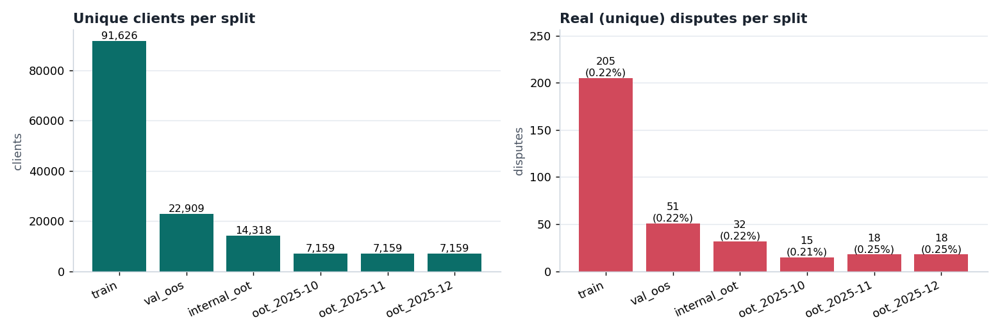
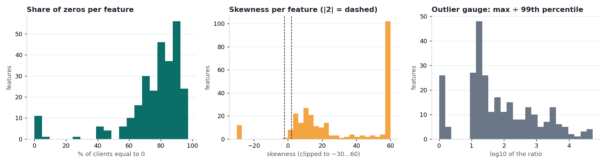
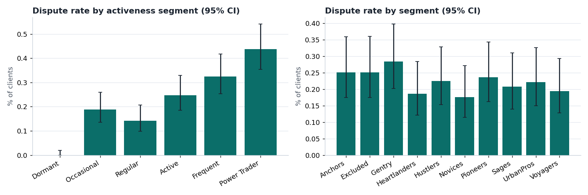
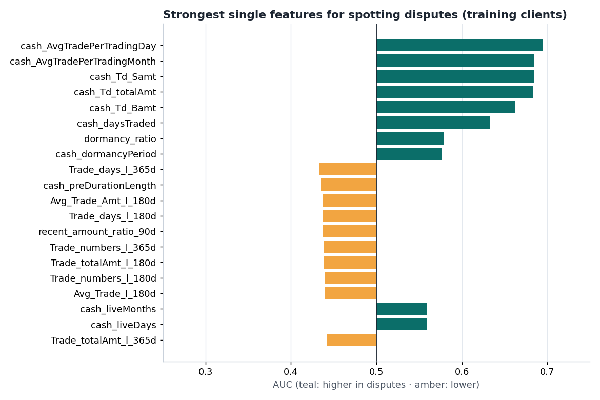
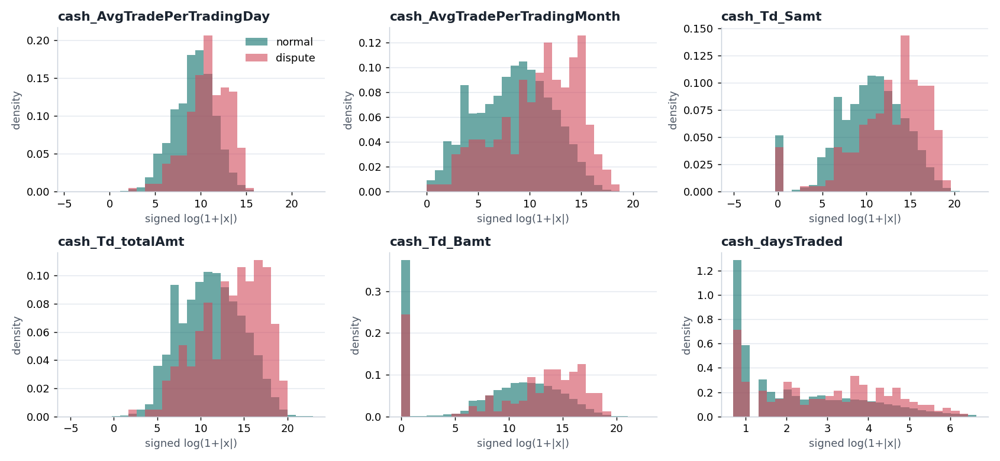
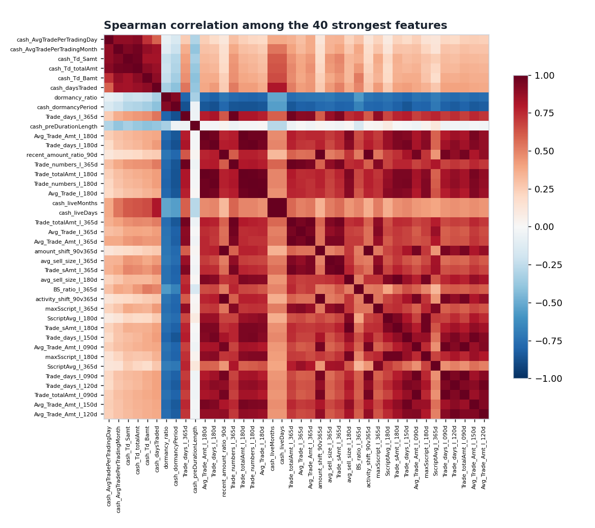
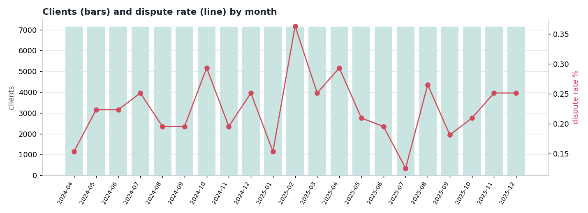
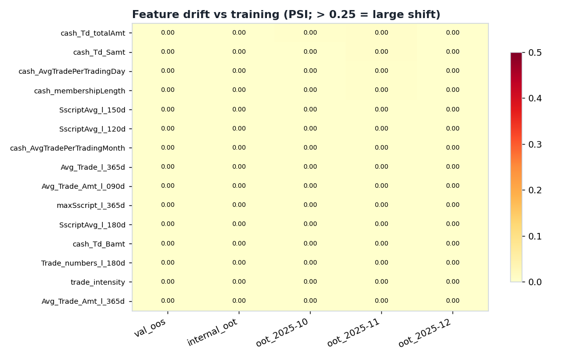

# TradeFraud — exploratory data analysis

Generated by `data/TradeFraud/scripts/run_eda.py`. Descriptive only: nothing here fits a model.
All feature statistics use the **training split after de-duplication** (`91,626` unique clients,
`205` real disputes) unless stated. Charts are in `EDA_Outputs/plots/`; every table below
is also saved as a CSV in this folder.

## 1. What the data looks like

- **271 model features** per client snapshot, from the variable dictionary's groups (below). 96 are
  integer-valued (counts, flags); 175 are continuous.
- **Missing values: none.** Missing data is not a problem in these splits.
- **Constant features: 0.** 248 features are zero for more than half of all clients (sparse activity features);
  42 contain negative values (net/imbalance measures).
- **Heavily skewed: 263 of 271 features have |skewness| > 2**, and 237 have a maximum more than 10× their
  99th percentile. This is why the autoencoder needs a log transform before it can learn (Phase 2).
- **Train and validation share no clients** (0 overlapping client IDs).

### Splits

| split | rows as supplied | dispute rows as supplied | unique clients | unique disputes | dispute rate % | min_date | max_date |
|---|---|---|---|---|---|---|---|
| train | 93480 | 2050 | 91626 | 205 | 0.224 | 2024-04-01 | 2025-07-31 |
| val_oos | 23368 | 510 | 22909 | 51 | 0.223 | 2024-04-01 | 2025-07-31 |
| internal_oot | 14606 | 320 | 14318 | 32 | 0.223 | 2025-08-01 | 2025-09-30 |
| oot_2025-10 | 7294 | 150 | 7159 | 15 | 0.210 | 2025-10-01 | 2025-10-31 |
| oot_2025-11 | 7321 | 180 | 7159 | 18 | 0.251 | 2025-11-01 | 2025-11-30 |
| oot_2025-12 | 7321 | 180 | 7159 | 18 | 0.251 | 2025-12-01 | 2025-12-31 |

**The dispute rows were duplicated 10× in the data as supplied.** After de-duplication the dispute rate is
**0.22%** of clients in training — roughly 1 in 450. A model that always says "no dispute" is
99.78% accurate, which is why accuracy is never reported. The out-of-time months have only
15–18 real disputes each, so any score measured on them is very uncertain.

### Feature groups

| group | features | mean % zeros | mean abs skew | max % missing |
|---|---|---|---|---|
| 2. Client Profile | 6 | 0.72 | 1.10 | 0.00 |
| 3. Lifetime Aggregates | 5 | 6.82 | 112.68 | 0.00 |
| 4. Rolling Window — Activity — Trading Frequency | 39 | 73.58 | 37.72 | 0.00 |
| 4. Rolling Window — Script Category — Average Composition | 26 | 79.20 | 14.55 | 0.00 |
| 4. Rolling Window — Script Category — Maximum Concentration | 26 | 79.20 | 19.13 | 0.00 |
| 4. Rolling Window — Script Category — Minimum Concentration | 26 | 90.55 | 15.99 | 0.00 |
| 4. Rolling Window — Trade Value — Amount Metrics | 52 | 76.39 | 150.60 | 0.00 |
| 7. Engineered — Behavioural Shift | 8 | 83.22 | 39.39 | 0.00 |
| 7. Engineered — Buy/Sell Imbalance | 26 | 77.62 | 209.47 | 0.00 |
| 7. Engineered — Dormancy & Recency | 5 | 47.40 | 2.73 | 0.00 |
| 7. Engineered — Script Concentration | 26 | 84.23 | 11.96 | 0.00 |
| 7. Engineered — Trade Size | 26 | 79.20 | 260.29 | 0.00 |

Most skewed features:

| feature | skew | zero_pct | median | p99 | max |
|---|---|---|---|---|---|
| avg_sell_size_l_003d | 302.50 | 94.19 | 0.00 | 14475.58 | 55891490.22 |
| avg_buy_size_l_060d | 301.98 | 82.15 | 0.00 | 20487.52 | 252507812.67 |
| avg_sell_size_l_060d | 301.92 | 79.10 | 0.00 | 19740.66 | 71046504.33 |
| avg_sell_size_l_075d | 301.85 | 76.19 | 0.00 | 20707.32 | 71046504.33 |
| avg_buy_size_l_075d | 301.64 | 80.38 | 0.00 | 20862.84 | 208001564.85 |
| avg_buy_size_l_090d | 301.01 | 78.64 | 0.00 | 21201.41 | 163655101.55 |
| avg_sell_size_l_120d | 300.89 | 68.59 | 0.00 | 22636.92 | 71046504.33 |
| avg_sell_size_l_090d | 300.77 | 72.67 | 0.00 | 21589.68 | 71046504.33 |

Sparsest features (share of clients with value exactly 0):

| feature | zero_pct | n_unique | integer_valued |
|---|---|---|---|
| bscript_range_l_003d | 97.3 | 22 | True |
| bscript_range_l_007d | 95.5 | 24 | True |
| minSscript_l_003d | 95.4 | 24 | True |
| minSscript_l_007d | 95.2 | 24 | True |
| minBscript_l_003d | 94.9 | 23 | True |
| avg_sell_size_l_003d | 94.2 | 5307 | False |
| Trade_sAmt_l_003d | 94.2 | 5288 | False |
| maxSscript_l_003d | 94.2 | 34 | True |

## 2. Who disputes? (segments)

Dispute rate with 95% confidence interval, training + validation clients pooled
(114,535 clients, 256 disputes).

**By activeness segment**

| segment | clients | disputes | dispute_rate_pct | ci95_lo_pct | ci95_hi_pct |
|---|---|---|---|---|---|
| Dormant | 19138 | 0 | 0.00 | 0.00 | 0.02 |
| Occasional | 19159 | 36 | 0.19 | 0.14 | 0.26 |
| Regular | 18974 | 27 | 0.14 | 0.10 | 0.21 |
| Active | 19018 | 47 | 0.25 | 0.19 | 0.33 |
| Frequent | 19060 | 62 | 0.33 | 0.25 | 0.42 |
| Power Trader | 19186 | 84 | 0.44 | 0.35 | 0.54 |

**By client segment**

| segment | clients | disputes | dispute_rate_pct | ci95_lo_pct | ci95_hi_pct |
|---|---|---|---|---|---|
| Anchors | 11566 | 29 | 0.25 | 0.17 | 0.36 |
| Excluded | 11558 | 29 | 0.25 | 0.17 | 0.36 |
| Gentry | 11624 | 33 | 0.28 | 0.20 | 0.40 |
| Heartlanders | 11300 | 21 | 0.19 | 0.12 | 0.28 |
| Hustlers | 11568 | 26 | 0.22 | 0.15 | 0.33 |
| Novices | 11341 | 20 | 0.18 | 0.11 | 0.27 |
| Pioneers | 11419 | 27 | 0.24 | 0.16 | 0.34 |
| Sages | 11515 | 24 | 0.21 | 0.14 | 0.31 |
| UrbanPros | 11307 | 25 | 0.22 | 0.15 | 0.33 |
| Voyagers | 11337 | 22 | 0.19 | 0.13 | 0.29 |

**Disputes track how active the client is.** The rate climbs from 0.00% in the Dormant segment
(0 disputes among 19,138 clients) to 0.44% for Power Traders. Dormant clients essentially never
dispute, and Power Traders dispute about 3.1× as often as Regular ones. The ten client
segments, by contrast, are all within sampling error of the overall rate — they carry little information about disputes.

## 3. Which single features separate disputes from normal clients?

Each feature used alone as a dispute score (AUC: 0.5 = no signal, 1.0 = perfect; direction-free strength = |AUC − 0.5|×2).

| feature | group | AUC (train) | AUC (validation) | direction |
|---|---|---|---|---|
| cash_AvgTradePerTradingDay | 3. Lifetime Aggregates | 0.695 | 0.735 | higher in disputes |
| cash_AvgTradePerTradingMonth | 3. Lifetime Aggregates | 0.684 | 0.755 | higher in disputes |
| cash_Td_Samt | 3. Lifetime Aggregates | 0.684 | 0.757 | higher in disputes |
| cash_Td_totalAmt | 3. Lifetime Aggregates | 0.683 | 0.757 | higher in disputes |
| cash_Td_Bamt | 3. Lifetime Aggregates | 0.663 | 0.758 | higher in disputes |
| cash_daysTraded | 2. Client Profile | 0.633 | 0.714 | higher in disputes |
| dormancy_ratio | 7. Engineered — Dormancy & Recency | 0.579 | 0.562 | higher in disputes |
| cash_dormancyPeriod | 2. Client Profile | 0.577 | 0.565 | higher in disputes |
| Trade_days_l_365d | 4. Rolling Window — Activity — Trading Frequency | 0.433 | 0.440 | lower in disputes |
| cash_preDurationLength | 2. Client Profile | 0.435 | 0.445 | lower in disputes |

**How to read this.** The strongest single feature reaches an AUC of 0.695 on training clients
(strength 0.390) and 0.735 on the validation clients it was not chosen on.
For calibration: with 205 disputes and 271 features, the best feature in *pure noise* (labels shuffled)
reaches a strength of only about 0.086. So the top features carry **real but modest** signal — 6 features
exceed twice the noise level — and it is concentrated in **lifetime activity volume** (total traded amounts, trades per day,
days traded). That matches Section 2: more active clients dispute more.

**Why it matters for the models:** on the validation clients, single activity-volume features score AUC
0.71–0.76 — *higher* than the best trained model
(0.716, logistic regression; ARCHITECTURE.md Section 4). The gap is within sampling error (the models' own 95% ranges are about
±0.09 with 51 validation disputes), so this is not proof that the models are worse, but it says clearly that **the models add
nothing measurable beyond "how active / how large is this client"**. Their explanations are therefore likely to be dominated by
activity-volume features, and a plain one-feature rule is a baseline any explanation story must be honest about.

## 4. Redundancy between features

486 feature pairs have |Spearman| ≥ 0.95, involving 211 of the 271 features. Many features are
rolling-window versions of one another (e.g. the same quantity over 7, 15 and 21 days), so the effective number of independent
signals is far smaller than 271. This matters for explanation: when features are near-copies, an explainer can
split credit between them arbitrarily, which is one reason different explainers disagree.

| feature_a | feature_b | spearman |
|---|---|---|
| cash_liveDays | cash_liveMonths | 1.000 |
| Trade_totalAmt_l_003d | Avg_Trade_Amt_l_003d | 1.000 |
| Trade_numbers_l_003d | Avg_Trade_l_003d | 1.000 |
| SscriptAvg_l_003d | maxSscript_l_003d | 1.000 |
| BscriptAvg_l_003d | maxBscript_l_003d | 1.000 |
| Trade_totalAmt_l_007d | Avg_Trade_Amt_l_007d | 1.000 |
| activity_shift_3v30d | amount_shift_3v30d | 1.000 |
| Trade_sAmt_l_003d | avg_sell_size_l_003d | 1.000 |

## 5. Time and drift

**Finding: the features do not drift.** Every feature has a PSI far below 0.1 in every later split, including all three
out-of-time months. Month to month the dispute rate moves between 0.13% and 0.36%
with no trend — what roughly 16 disputes per month produce by chance. Each client appears once (one snapshot),
no client appears in two out-of-time files, and every calendar month holds almost exactly the same number of clients
(7,156–7,159), i.e. the months are equal-sized cohorts. So the "out-of-time" months are
effectively *fresh clients drawn from the same distribution*, not a population that changed. Consequence: TradeFraud's
out-of-time results are a second out-of-sample test, **not a stress test of behaviour change** — a model that does well there
has not proved it survives drift. (PSI is computed on the training deciles; for the many features that are over 75% zeros it
has only a few bins and is less sensitive, so this is a statement about the bulk of each distribution.)

Population Stability Index of each feature against the training split (< 0.1 stable · 0.1–0.25 moderate · > 0.25 large):

| split | features_psi_gt_0.1 | features_psi_gt_0.25 | median_psi |
|---|---|---|---|
| val_oos | 0 | 0 | 0.000 |
| internal_oot | 0 | 0 | 0.000 |
| oot_2025-10 | 0 | 0 | 0.000 |
| oot_2025-11 | 0 | 0 | 0.000 |
| oot_2025-12 | 0 | 0 | 0.000 |

Features that drift most:

| feature | group | val_oos | internal_oot | oot_2025-10 | oot_2025-11 | oot_2025-12 |
|---|---|---|---|---|---|---|
| cash_Td_totalAmt | 3. Lifetime Aggregates | 0.000 | 0.000 | 0.002 | 0.004 | 0.001 |
| cash_Td_Samt | 3. Lifetime Aggregates | 0.000 | 0.001 | 0.001 | 0.004 | 0.001 |
| cash_AvgTradePerTradingDay | 3. Lifetime Aggregates | 0.001 | 0.001 | 0.001 | 0.003 | 0.001 |
| cash_membershipLength | 2. Client Profile | 0.000 | 0.000 | 0.001 | 0.002 | 0.000 |
| SscriptAvg_l_150d | 4. Rolling Window — Script Category — Average Composition | 0.000 | 0.000 | 0.002 | 0.001 | 0.001 |
| SscriptAvg_l_120d | 4. Rolling Window — Script Category — Average Composition | 0.000 | 0.000 | 0.002 | 0.000 | 0.001 |
| cash_AvgTradePerTradingMonth | 3. Lifetime Aggregates | 0.000 | 0.001 | 0.001 | 0.002 | 0.001 |
| Avg_Trade_l_365d | 4. Rolling Window — Activity — Trading Frequency | 0.000 | 0.001 | 0.001 | 0.002 | 0.000 |
| Avg_Trade_Amt_l_090d | 4. Rolling Window — Trade Value — Amount Metrics | 0.000 | 0.000 | 0.000 | 0.000 | 0.001 |
| maxSscript_l_365d | 4. Rolling Window — Script Category — Maximum Concentration | 0.000 | 0.000 | 0.001 | 0.001 | 0.001 |

## 6. What this means for the project

1. **Very few real disputes** (205 train, 51 validation, 15–18 per OOT month): every model score and every
   explanation-quality number needs its confidence interval.
2. **Skewed, sparse, redundant features:** preprocessing (signed log, scaling, clipping) is required for the autoencoder,
   and explanations should be read at feature-*group* level as well as per feature.
3. **Modest, activity-driven signal:** a single volume feature matches or beats every trained model on validation, and Dormant
   clients never dispute. Weak AUCs are largely a property of this data. Expect explanations to point mostly at activity-volume features.
4. **No drift in this data:** out-of-time results here do not test robustness to change. Out-of-time CLI stability (Phase 4) is
   therefore not evidence about drift on TradeFraud; DemandForecast (a real time series) is the better place to look.
